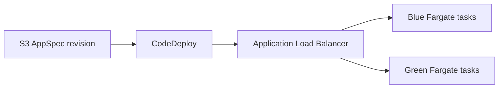
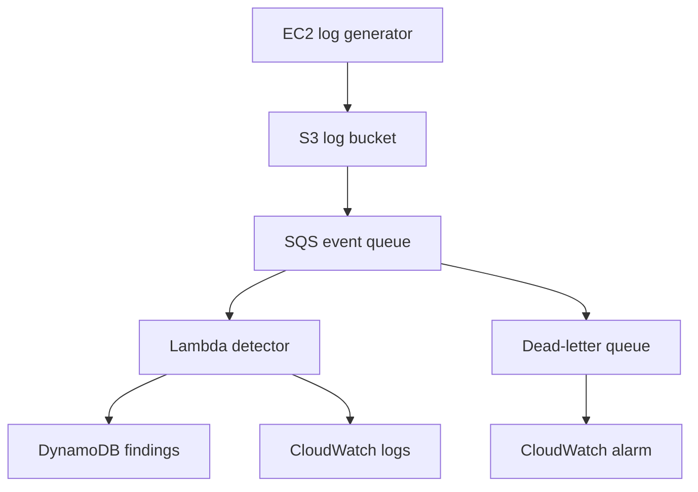

# AWS Cloud Security & Infrastructure

University of Maryland cloud infrastructure coursework and a Terraform-managed security monitoring demo.

## Verification status

All seven unit tests and Terraform validation passed locally. [GitHub Actions CI passed](https://github.com/S18-01/AWS-Cloud-Security-Infrastructure/actions/runs/45555781051).

Live AWS verification is pending. The UMD student profile lacked `ec2:DescribeVpcAttribute` for the VPC lookup and `ssm:GetParameter` for the AMI lookup. Terraform stopped during planning before creating any AWS resources.

## Completed UMD coursework

| ENPM 818R exercise | Recorded result |
| --- | --- |
| EKS Fundamentals | Deployed NGINX in `us-east-1` under `student-smuragun`, scaled from two to three replicas, and verified HTTP 200 via port forwarding to a ClusterIP service. |
| ECS and Fargate | Configured the container task definition and Fargate service. |
| Blue-green deployment | Configured an ALB listener and two target groups, CodeDeploy, and an S3-hosted AppSpec revision. Deployment `d-7OIN256VM` succeeded. The final recorded cleanup check showed zero running tasks and a draining service. |

The original coursework files are on another machine. The portfolio demo uses its own AWS resources.



## Additional UMD coursework references

- **AWS VPC Creation, EC2 Deployment, and VPC Flow Log Monitoring.** Covered VPC networking, EC2 deployment, and network log monitoring.
- **Investigating an AWS Breach with CloudTrail & IAM.** Covered preparing CloudTrail records for analysis and using IAM context during a breach investigation.
- **Homework: IAM Enumeration Lab.** Covered reviewing IAM users, roles, and policies in a course lab.

These assignments provide background for the portfolio demo, which uses synthetic SSH events generated by EC2.

## Security monitoring demo



EC2 generates eight synthetic SSH events on first boot and uploads one JSON batch with a unique object key. Five failure events from the same IP in one object trigger a medium-severity finding. The rule evaluates each object independently. Conditional DynamoDB writes deduplicate redeliveries, and partial batch responses retry individual failed SQS messages. A CloudWatch alarm monitors visible dead-letter messages. The alarm is visible in the console.

The producer role can only upload to the log prefix. Lambda can consume the intake queue, read the log prefix, put findings in one table, and write to its own CloudWatch log group. S3 blocks public access, denies plaintext transport, encrypts objects, and expires demo logs after seven days. SQS uses managed server-side encryption. The EC2 security group has zero inbound rules, IMDSv2 is required, and the root EBS volume is encrypted.

## Windows PowerShell

Run from the repository root. Requirements are Python 3.12, Terraform 1.5+, AWS CLI v2, and AWS credentials with permission to provision the demo. The deployment uses `us-east-1` and requires a default VPC with an internet-routed default subnet in that region. The verify script runs locally without AWS credentials.

```powershell
powershell -NoProfile -ExecutionPolicy Bypass -File .\Verify-Project.ps1
```

The deploy script displays the AWS identity and plan and waits for you to type `deploy`. It checks DynamoDB for one medium finding for `192.0.2.10` with five attempts and retrieves the Lambda logs.

```powershell
powershell -NoProfile -ExecutionPolicy Bypass -File .\Deploy-Demo.ps1
```

If no finding appears, inspect Lambda CloudWatch logs and the EC2 system output. The producer is designed to stop after the upload or its final retry. The demo uses a small EC2 instance, one public IPv4 address while running, on-demand DynamoDB, and no NAT gateway. A stopped instance can still incur EBS and other stack charges. After capturing evidence, destroy the dedicated demo stack. This deletes the demo data.

```powershell
terraform '-chdir=security-pipeline' destroy
```

## GitHub publishing

Run local verification, then review the staged files. Terraform state and plans are excluded from Git. Commit the provider lockfile generated by initialization to pin the versions selected locally.

```powershell
git add -- README.md .gitignore Verify-Project.ps1 Deploy-Demo.ps1 .github/workflows/security-pipeline.yml security-pipeline
git diff --cached --check
git status --short
git commit -m "Add AWS security monitoring pipeline and document UMD coursework"
git push -u origin feature/security-log-pipeline
```

Open a pull request into `main` and check the **Security pipeline CI** job before merging.
